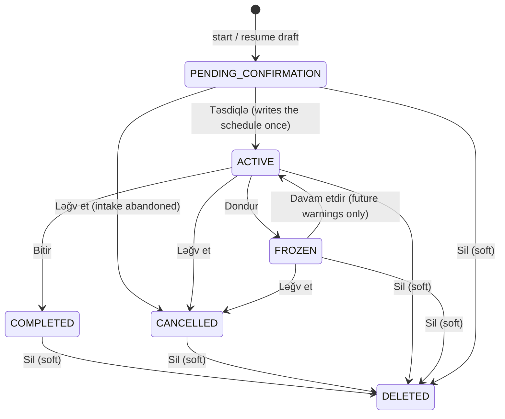

# Orders workflow and reminder schedule (owner contract V2 §3)

Reconciled 2026-11-10. This describes what is implemented on
`feature/v2-owner-requirements-2026-11-08`, not a target state. The contract text is
`docs/V2-OWNER-REQUIREMENTS-2026-11-08.md` §3.1–§3.4; the private Master Spec numbers the
same rules §14–§15.

## What exists and what does not

Implemented now — the domain rules, the storage, and the application service that an
adapter can call:

- `office_assistant/orders/workflow.py` — states, allowed actions, intake order, derived
  overdue.
- `office_assistant/orders/schedule.py` — the `I = L / N` formula and the idempotency key.
- `office_assistant/infrastructure/database/models.py` + migration
  `0026_orders` — `orders`, `order_reminders`, `order_attachments`.
- `office_assistant/application/orders.py` — durable drafts, confirmation, review,
  lifecycle, rescheduling, list/detail views.

Not implemented yet, by scope rather than by omission:

- **The Telegram adapter** (the `Sifarişlərim` menu row, the six questions, the review
  buttons). No user can reach the service from the bot until that slice lands; the
  `orders` capability therefore stays disabled in the rollout baseline
  (OPEN-QUESTIONS Q46) so a menu can never offer what the backend cannot show.
- **The delivery engine** (Milestone 3). Confirmation writes the ledger rows and the
  lifecycle stops or reopens them, but nothing claims or sends them yet, so `SENT`,
  `CLAIMED`, `SENDING`, `RETRY_PENDING` and `FAILED` are written only by the delivery
  engine or seeded by a test.

## Where each decision lives

`orders/` imports no database session, no Telegram type and no inventory model, so the
contract can be tested on either side of that line. The service owns transactions and
row locks; the domain modules own the arithmetic and the state table. The adapter, when
it arrives, will only turn buttons into typed calls — it must not re-implement any rule
below.

## States

`OVERDUE` is deliberately absent from the stored column. It is derived from the deadline
at read time, so a clock change can never make a record claim a state it was not given,
and a frozen or finished order is never "late".



Every state except `DELETED` accepts `Sil`; `DELETED` is the recoverable soft-delete the
contract asks for (§3.4) and is reachable from all five others, but nothing leaves it.
The archive keeps the row, its materials and its ledger — permanent purge needs a
separately approved retention policy.

## Intake: six questions, one row

The draft **is** the `orders` row, so every answer is committed before the next question
is asked and a restart resumes the same conversation instead of starting over.

| # | Field | Accepted | Refused with a targeted clarification |
| --- | --- | --- | --- |
| 1 | `deadline` | timezone-aware `datetime`, normalised to UTC | a naive datetime (names no instant); a moment already past |
| 2 | `lead_time` | whole minutes, `1 … MAX_LEAD_MINUTES` | text, a float, a negative, zero, bool |
| 3 | `warnings` | whole number, 1 … 10 (`schedule.MIN/MAX_WARNINGS`) | `True` (a bool is not a count), 0, 11, negative |
| 4 | `requester` | non-empty free text, trimmed, 4 000 chars | blank or whitespace-only |
| 5 | `description` | non-empty free text, trimmed, 4 000 chars | empty |
| 6 | `notes` | optional; empty stays empty | — |

A refused answer never reaches the record: the answer is validated inside the same
transaction that would write it, so the stored row keeps its previous value and
`confirm` still reports the first field that is genuinely missing (§3.2 "reject invalid
values with a targeted clarification"). `notes` is the only optional answer, so a draft
is confirmable without it, while `next_open_field` still lists it last as the question to
ask.

Two identities stay separate, exactly as §3.2 requires: `created_by_user_id` is the
Telegram account that made the order and owns it, `requested_by` is the person the order
was made for and is free text. Reminders go to the creator only (§3.3), so the named
requester never receives anything.

One open draft per account is a database rule, not a convention:
`uq_orders_one_open_draft` is a partial unique index on `created_by_user_id` where
`state = 'PENDING_CONFIRMATION'`. `start()` returns the existing draft rather than
inserting a second one, so intake cannot mix two orders in the same conversation.

Uploaded material is referenced, never copied: `order_attachments` points at a
`file_object` row and records `added_by_user_id` plus the `telegram_message_id` it
arrived in (§3.1 provenance). Extraction, when it runs, produces suggestions for the
review page — the authoritative record exists only after the explicit confirmation, and
`confirm()` is idempotent because a retried tap finds the same row by its intake token,
sees a state past `PENDING_CONFIRMATION` and returns it untouched.

## The reminder schedule

For `N > 0` warnings across a lead window `L` ending at deadline `D`:

```
I = L / N
T(i) = D - L + i × I        for i = 0 … N-1
```

so the first warning is exactly at `D - L` and the last lands one interval before `D`;
there is no warning at the deadline itself. The owner's worked example, `L = 48 h`,
`N = 5` (`tests/unit/test_order_schedule.py` pins these numbers):

| i | instant | before deadline |
| --- | --- | --- |
| 0 | `D - 48 h` | 48 h |
| 1 | `D - 38 h 24 m` | 38 h 24 m |
| 2 | `D - 28 h 48 m` | 28 h 48 m |
| 3 | `D - 19 h 12 m` | 19 h 12 m |
| 4 | `D - 9 h 36 m` | 9 h 36 m |

The interval is `9 h 36 m`, which does not divide the window into whole hours. The
formula is applied to a `timedelta`, so `L` not divisible by `N` still yields `N` strictly
increasing instants that end one interval before `D`; nothing rounds.

A deadline may be handed over in the order's own zone. `review_instants` normalises to
UTC, so the plan for `2026-11-15 09:00 Asia/Baku` is the same five instants as for the
equivalent UTC instant. The order keeps `timezone` (default `Asia/Baku`, the user's
configured zone) for display (§3.3), and the confirmation metadata records it.

## The ledger, and what writes each row

Each planned instant is one `order_reminders` row keyed by
`order:<order_id>:<scheduled_for ISO-8601>`. That key is the uniqueness guard
(`uq_order_reminder_idempotency`), and `(order_id, scheduled_for)` is unique too
(`uq_order_reminder_instant`), so a double tap, a worker replay or two processes
claiming at once cannot add a second warning for the same moment.

| Status | Meaning | Written by |
| --- | --- | --- |
| `PENDING` | future instant, waiting | `_plan` on confirm / resume / reschedule |
| `SKIPPED` | the instant was already past when the plan was made | `_plan` (disclosed, never sent) |
| `CLAIMED`, `SENDING`, `RETRY_PENDING`, `SENT`, `FAILED` | delivery vocabulary | Milestone 3 engine |
| `CANCELLED` | stopped before it happened | freeze, complete, cancel, delete |
| `SUPERSEDED` | replaced by a newer plan | reschedule |

Concretely (§3.3 "do not send a burst of stale warnings"): confirming an order whose lead
window already started writes a `SKIPPED` row for each past instant and a `PENDING` row
only for the future ones. The order view then reports `planned`, `delivered`, `skipped`
and `failed` counts, so the user sees that two warnings were never going to arrive rather
than receiving them late.

Freezing sets every not-yet-delivered entry to `CANCELLED`. Resuming recomputes the plan
against the existing deadline and reopens **only** the cancelled entries that are still
ahead of now — past instants stay cancelled, so resuming never replays a reminder.
Completing, cancelling, deleting and freezing all stop future deliveries; a frozen order
cannot send anything.

Rescheduling supersedes the pending entries of the old plan instead of deleting them,
writes the new plan, and leaves a warning that already arrived (`SENT`) untouched: the
history of what happened stays readable next to the new plan.

## Lifecycle actions

| Azerbaijani label | Action | Ledger effect | Timestamp |
| --- | --- | --- | --- |
| Bitir | `COMPLETE` | stops pending | `completed_at` |
| Dondur | `FREEZE` | cancels pending | `frozen_at` |
| Davam etdir | `RESUME` | reopens future only | — (no stamp; it is not a new event) |
| Ləğv et | `CANCEL` | stops pending | `cancelled_at` |
| Sil | `DELETE` | stops pending, row kept | `deleted_at` |

`list()` serves the `Sifarişlərim` filters — `OPEN` (active and frozen, ordered by
deadline), `OVERDUE` (derived, active only), `FROZEN`, `ARCHIVED` (completed and
cancelled) and `DRAFTS` — and returns nothing from `DELETED`, which is why a soft delete
disappears from every view while its ledger survives for reporting. `detail()` returns the
order, its warnings with statuses, its materials, derived overdue and remaining time, and
the most recent 20 audit events.

## Boundaries that will not move

An order never reads or writes inventory, and confirming one changes no stock. Prices,
quantities and scheduled instants come from this database and from the deterministic
formula, never from a model (§Master Spec invariant 3). Anything extracted from an
uploaded document or photo is a suggestion on the review page until the user confirms it.
Every entry point re-checks the `orders` capability at the service boundary, so a user
whose toggle is off cannot drive the workflow by replaying a callback.

## Evidence

- Unit (`tests/unit/test_order_schedule.py`, `tests/unit/test_order_workflow.py`) —
  the worked example, non-dividing intervals, a localised deadline producing the same
  plan, every refusal reason, the state table, the soft-delete reachability, derived
  overdue.
- Integration (`tests/integration/test_orders_db.py`, real PostgreSQL 17) — restart-safe
  intake and one-draft-per-account, the exact five-row plan, idempotent confirmation,
  stale warnings stored `SKIPPED`, freeze/resume with forty hours passing, complete and
  soft delete, per-user isolation, a disabled capability refused at the boundary, invalid
  answers never reaching the record, reschedule superseding while a delivered row survives,
  attachment provenance, creator versus requester, cascade on account removal.

## Assumptions recorded

`MAX_LEAD_MINUTES` (one year) is OPEN-QUESTIONS Q47. The remaining open points — the
semantics of rescheduling a frozen order, which file types and how many an order may
carry, whether `requested_by` should resolve to an account, and how long a soft-deleted
order survives before purge — are listed in Q47 and in
`docs/V2-REQUIREMENTS-GAP-ANALYSIS-2026-11-08.md` rather than decided in code.
