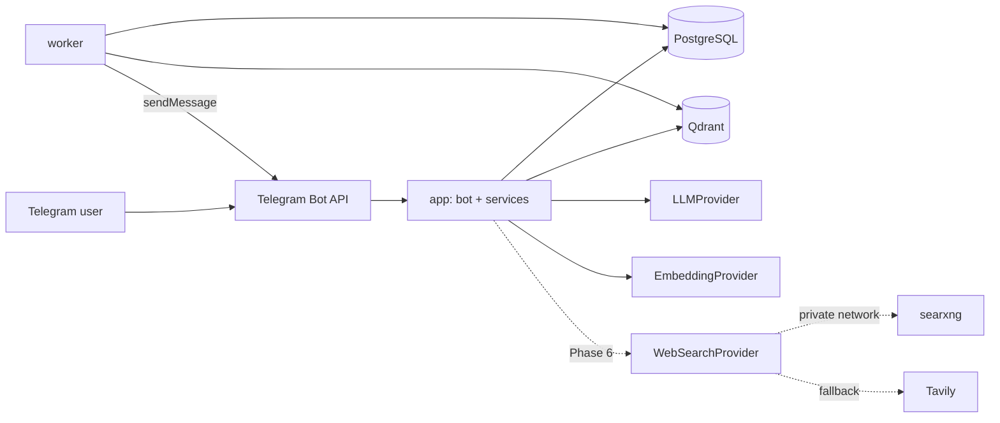

# SPEC — Azerbaijani Telegram AI Assistant

> **Status note (2026-10-10):** This file is a historical reconciled V1 design,
> not the complete owner-approved Master Specification dated 2026-10-07. The Master
> Specification is maintained outside this public repository; when provided, it
> takes priority over older recommendations here. Later owner decisions and the
> implemented status are recorded in `OPEN-QUESTIONS.md`, `ROADMAP.md` and ADRs.
> In particular, Phase 11 web search and Phase 12A image foundations have been
> implemented; OCR/visual benchmarks (12B), multimodal search (12C), and final
> production acceptance remain future work.

Status: v1.0 reconciled specification. Audience: the coding agent (Qoder + Qwen 3.8) and the project owner.

## 0. Provenance and confidence

This spec merges two inputs: (a) a generic research report written WITHOUT access to the owner's original conversation, and (b) the owner's APPROVED architecture decision for web search (ADR-001). Where they conflict, the owner's decision wins.

Every statement is tagged implicitly by section:

| Tag             | Meaning                                                                  |
| --------------- | ------------------------------------------------------------------------ |
| **DECIDED**     | Approved by the owner. Do not change without a new ADR.                  |
| **RECOMMENDED** | Sensible default. Follow it unless`OPEN-QUESTIONS.md` records otherwise. |
| **OPEN**        | Not known. Ask, do not guess. See`OPEN-QUESTIONS.md`.                    |

Dropped from the research report because they conflict with the decided stack or are irrelevant: Supabase, pgvector, Google Cloud Run, OpenAI-specific pricing and model names, the Turkish KVKK legal framing, Turkish-language examples, cost tables, team/timeline estimates, enterprise roadmap.

## 1. Product summary (DECIDED unless noted)

An Azerbaijani-language Telegram assistant for a business context. Capabilities:

1. RAG question answering over an internal knowledge base, with citations.
2. Natural-language reminders delivered reliably through Telegram.
3. Answers from structured company data: company facts, product prices, customer facts (from PostgreSQL).
4. User-approved permanent memory.
5. Controlled web search (V1 scope, but implemented last — Phase 6): `/internet` and `/tamaxtar`.
6. Agent routing: natural-language messages are routed to the right handler; explicit commands always override routing.

Users and roles: the earlier allowlist-only recommendation is **superseded** by Master Spec §4 and the implemented password bootstrap. The first valid password holder becomes ADMIN; later valid holders await administrator approval. Only ACTIVE authenticated users access authoritative operations.

## 2. Scope

In scope for V1: text messages in private chats; Azerbaijani UI; items 1–6 above; Docker Compose deployment on one VM; offline-runnable tests; structured logs.

Out of scope for V1: group chats, voice, web admin panel, calendar integrations, recurring reminders (field reserved in schema), multi-tenant organizations, billing, SSO, multi-vendor LLM failover, autonomous browsing, any action on third-party systems.

Amendment (2026-10-06, revised 2026-10-07, `docs/architecture/decisions/0017-vision-extraction-for-images.md`):
uploaded raster images (JPEG/PNG photos of documents) are in scope as *query parameters* — the image
attached to an explicit command, or the one the user replies to, is read on demand for the question
the user asked. Automatic transcription on upload, added on 2026-10-06, was
withdrawn by the 2026-10-07 amendment to ADR 0017: an uploaded photo keeps a `DEFERRED` parse run and
is not searchable knowledge until it is read for a turn or made durable through the explicit
Phase 12A confirmation flow. Voice messages, scanned PDFs (page rasterization) and image embeddings
remain out of scope.

## 3. Architecture

DECIDED services (Docker Compose, one VM): `app`, `worker`, `postgres`, `qdrant`, and in Phase 6 `searxng`. No Redis unless a concrete technical need is proven and recorded in an ADR.

Responsibilities:

- `app`: receives Telegram updates, authorizes, routes, calls services, replies. Stateless apart from the database.
- `worker`: reminder dispatcher loop, ingestion jobs (parse → chunk → embed → upsert), cache cleanup, retention jobs. Reads work from PostgreSQL (`jobs` table with `FOR UPDATE SKIP LOCKED`; reminders have their own claim loop).
- `postgres`: system of record for everything, including chunk text. Not published to the host network.
- `qdrant`: vector index only. Rebuildable from PostgreSQL. Not published to the host network.
- Ops (RECOMMENDED): pin all image versions; healthchecks on every service; `restart: unless-stopped`
  on every long-running service *including* `postgres`, `qdrant` and `searxng`, because `app` and
  `worker` restarting alone against a stopped dependency only produces name-resolution failures;
  nightly `pg_dump` to storage outside the VM; Qdrant is restored by re-indexing from PostgreSQL or
  via snapshots. The pooled engine pings every connection at checkout and recycles it after
  `POSTGRES_POOL_RECYCLE_SECONDS` (default 900), since a dependency restart leaves sockets the
  server already closed; `app` and `worker` each compare their own clock to PostgreSQL `now()` at
  startup and log a warning past `CLOCK_DRIFT_WARNING_SECONDS` (default 120) instead of exiting.

Telegram transport (RECOMMENDED, OPEN Q4): long polling by default (no public ingress, simplest on a VM). Keep the transport behind an interface so a webhook (behind a reverse proxy such as Caddy, with `secret_token` verification) can replace it without touching handlers.

## 4. Bot behavior

### 4.1 Commands (names are lowercase ASCII — Telegram forbids Azerbaijani letters in command names)

| Command              | Status      | Behavior                                                                                                                                                         |
| -------------------- | ----------- | ---------------------------------------------------------------------------------------------------------------------------------------------------------------- |
| `/start`             | RECOMMENDED | Greets, checks allowlist, asks for timezone (default`Asia/Baku`), registers the user.                                                                            |
| `/help`              | RECOMMENDED | Lists capabilities in Azerbaijani.                                                                                                                               |
| `/hatirlatmalar`     | RECOMMENDED | Lists active reminders with inline cancel buttons.                                                                                                               |
| `/internet <sorğu>` | DECIDED     | External search only. Returns an answer with URLs/citations. Phase 6.                                                                                            |
| `/tamaxtar <sorğu>` | DECIDED     | Combines PostgreSQL + Qdrant + web results; presents company facts, internal document facts and external information in three clearly separated blocks. Phase 6. |
| `/saxla`             | DECIDED     | Explicit save flow (propose → preview → confirm → write with provenance).                                                                                     |
| `/verilerimi_sil`    | RECOMMENDED | Deletes the caller's personal data after confirmation.                                                                                                           |

Plain messages go through the router (§8). Exact command names other than the DECIDED ones are proposals; if the owner changes them, update `src/bot/commands.py` only.

### 4.2 UX rules

- All user-facing text is Azerbaijani, in `src/bot/messages/az.py`.
- Long operations show the typing action. Errors are short, friendly, and never expose internals.
- Answers that use sources end with a "Mənbələr" list.
- If nothing relevant is found: say so plainly. Never fabricate.

## 5. Reminders (RECOMMENDED; details in `.qoder/rules/30-reminders.md`)

Flow: user message → intent `reminder_create` → LLM extracts `{text, datetime|relative expression, needs_clarification}` → code resolves time with the user's timezone and an injected clock → bot shows the interpretation with Confirm/Edit/Cancel → on confirm, insert row (UTC) → dispatcher delivers.

Data: `reminders` + `reminder_deliveries` (ledger). State machine for a delivery: `claimed → sending → sent`; on failure `retry_pending → failed`. Unique `(reminder_id, scheduled_for)`.

Dispatcher: worker loop every 15–30 s, atomic claim via `FOR UPDATE SKIP LOCKED`. Delivery target: P95 lateness ≤ 60 s. Policy: at-least-once; Telegram's `sendMessage` is not idempotent, so a crash between send and commit can rarely cause a duplicate. This is accepted and documented.

Azerbaijani golden cases to cover (the owner must review them as a native speaker): "sabah saat 9-da Əliyə zəng etməyi xatırlat", "birisigün axşam 7-də", "2 saatdan sonra", "gələn həftə cümə günü", "ayın 15-də", "bu gün 18:30", "bazar ertəsi səhər". Ambiguous words trigger a clarifying question or a confirmed default.

V1 excludes recurrence and snooze; keep `recurrence_rule` nullable and unused.

## 6. RAG and knowledge base (RECOMMENDED; details in `.qoder/rules/40-rag-evidence.md`)

Ingestion (worker job): parse → normalize → heading-aware chunking (defaults 500–800 tokens, 10–15 % overlap, configurable) → embed via `EmbeddingProvider` → upsert to Qdrant → record in PostgreSQL. First formats: `.txt`, `.md`, text-layer `.pdf`. Other formats are OPEN (Q2). Idempotent by checksum.

Retrieval: embed query → Qdrant search with mandatory scope filter (`org` documents for everyone allowed; `user` documents only for the owner) → top-k (default 6–8) → minimum score threshold → context assembly with `[S#]` labels.

Generation: system rules + `<untrusted_context>` block; answer in Azerbaijani with `[S#]` citations; post-validate citations; "not found in sources" path when below threshold.

Azerbaijani quality: the embedding model MUST be evaluated on Azerbaijani text before it is chosen (OPEN Q3). Build `evals/rag_az.jsonl` early (question, expected source, expected facts, answerable yes/no). Proposed gates, not requirements from the owner: grounded-answer pass rate ≥ 90 %, valid-citation rate ≥ 95 %, correct "not found" on unanswerable questions ≥ 90 %.

## 7. Structured company data, memory and `/saxla`

- `facts` holds company facts, product prices and customer facts. Queried deterministically; the LLM never supplies the numbers. Schema is a proposal (OPEN Q5); keep it generic (`kind`, `subject`, `attribute`, `value jsonb`, validity dates, source).
- Permanent memory is created only through the `/saxla` flow or an explicit "yadda saxla" request, always with a confirmation step.
- Web results stay external evidence until the user confirms `/saxla`. Provenance (URL, `retrieved_at`, saver) is stored with the saved item.
- Org-level writes need `admin`. All writes go to `audit_log`.

## 8. Agent routing

1. Explicit command → handler (deterministic override, always wins).
2. Cheap deterministic rules (for example a message that starts with a clear reminder phrase).
3. LLM classifier with strict JSON output `{intent, confidence}`; intents: `rag_qa`, `facts_lookup`, `reminder_create`, `reminder_manage`, `web_search` (disabled until Phase 6), `smalltalk`, `unknown`.
4. Low confidence → one clarifying question.

Natural-language auto-routing to web search is a FUTURE option (ADR-001): behind a config flag, off by default.

## 9. Provider abstractions (DECIDED principle)

Create these interfaces; each has a fake for tests and a real implementation chosen by config:

- `LLMProvider`: `chat(messages, schema|None, params) -> LLMResult` with token usage. The real client is OpenAI-compatible HTTP (works with OpenAI, Alibaba Model Studio/Qwen, vLLM, etc.). The vendor is OPEN (Q3).
- `EmbeddingProvider`: `embed(texts) -> list[vector]`; model name and dimension from config.
- `WebSearchProvider`: see ADR-001. Phase 6.
- `TelegramTransport` and `TelegramSender`: so tests never touch the network.
- `Clock`.

## 10. Data model (RECOMMENDED; one Alembic migration per phase)

| Table                        | Key columns                                                                                                                                                             |
| ---------------------------- | ----------------------------------------------------------------------------------------------------------------------------------------------------------------------- |
| `users`                      | `id uuid pk`, `telegram_user_id bigint unique`, `telegram_chat_id`, `display_name`, `locale default 'az'`, `timezone default 'Asia/Baku'`, `role`, `status`, timestamps |
| `processed_updates`          | `update_id bigint pk`, `received_at`                                                                                                                                    |
| `conversation_turns`         | `id`, `user_id`, `role`, `content`, `created_at`; short retention (default 7 days, configurable)                                                                        |
| `reminders`                  | `id`, `user_id`, `text`, `timezone`, `due_at_utc`, `recurrence_rule null`, `next_run_at`, `status`, `idempotency_key unique`, `created_at`                              |
| `reminder_deliveries`        | `id`, `reminder_id`, `scheduled_for`, `status`, `attempt_count`, `claimed_at`, `sent_at`, `telegram_message_id`, `last_error`; unique `(reminder_id, scheduled_for)`    |
| `knowledge_sources`          | `id`, `scope ('org'                                                                                                                                                     |
| `knowledge_chunks`           | `id uuid (= Qdrant point id)`, `source_id`, `chunk_index`, `content`, `token_count`, `metadata jsonb`, `embedding_model`, `created_at`                                  |
| `facts`                      | `id`, `kind ('company'                                                                                                                                                  |
| `memories`                   | `id`, `scope`, `user_id null`, `content`, `source_ref jsonb`, `approved_at`, `created_at`                                                                               |
| `jobs`                       | `id`, `type`, `payload jsonb`, `status`, `attempts`, `run_at`, `locked_by`, `locked_at`, `last_error`                                                                   |
| `audit_log`                  | `id`, `actor_user_id`, `action`, `target_type`, `target_id`, `details jsonb`, `created_at`                                                                              |
| `web_search_cache` (Phase 6) | `key text pk` (hash of normalized query + provider + options), `provider`, `query_norm`, `options jsonb`, `results jsonb`, `retrieved_at`, `expires_at`, `hit_count`    |
| `web_search_log` (Phase 6)   | `id`, `provider_primary`, `provider_used`, `query_hash`, `result_count`, `latency_ms`, `fallback_used`, `fallback_reason`, `cost_estimate`, `created_at`                |

## 11. Security and privacy

11.1 Access: allowlist + roles; authorize before any processing; rate limit per user (messages/min and LLM tokens/day, configurable) to control abuse and cost.

11.2 Prompt-injection posture (DECIDED): retrieved documents, web results and fetched pages are untrusted data. The LLM has no side-effecting tools; it returns structured output that code validates. No retrieved text can change permissions or rules.

11.3 Secrets and logs: environment only; `.env.example` committed with empty values; structured logs never contain tokens, keys or full message text.

11.4 SSRF protection for any server-side URL fetch (Phase 6): http/https only; resolve DNS and reject loopback, private, link-local, CGNAT and cloud-metadata ranges (for example `169.254.169.254`); pin the resolved IP for the request; re-validate on every redirect (max 3); ports 80/443 only; size cap (default 2 MB); total timeout; allowlisted content types; no cookies or credentials.

11.5 Data minimization and retention: configurable retention for conversation turns; `/verilerimi_sil`; explain to users that an external AI provider processes their messages. Legal basis and cross-border transfer rules are OPEN (Q9): Azerbaijani personal-data law applies; the Turkish KVKK material in the research report does not. This project does not provide legal advice; the owner should consult counsel before production.

## 12. Configuration and observability

`.env.example` must include at least: `TELEGRAM_BOT_TOKEN`, `TELEGRAM_ALLOWED_USER_IDS`, `TELEGRAM_ADMIN_USER_IDS`, `DATABASE_URL`, `QDRANT_URL`, `LLM_BASE_URL`, `LLM_API_KEY`, `LLM_MODEL`, `EMBEDDING_BASE_URL`, `EMBEDDING_API_KEY`, `EMBEDDING_MODEL`, `EMBEDDING_DIM`, `RAG_TOP_K`, `RAG_MIN_SCORE`, `DEFAULT_TIMEZONE`, `LOG_LEVEL`, and (Phase 6) the keys listed in ADR-001.

Observability: JSON logs with `request_id`, `intent`, `provider`, `latency_ms`, token usage; `/healthz` or equivalent container healthcheck; a daily cost/usage log line; counters for reminders sent/failed and fallback usage.

## 13. Testing and quality gates

- `make test` runs fully offline using fakes and an injected clock.
- Unit tests for date resolution (including DST zone), claim/ledger logic, access filters, citation validation, router decisions, command-name validity.
- Integration tests against real PostgreSQL and Qdrant containers (Compose test profile) for migrations, claim concurrency (`SKIP LOCKED` with two workers), ingestion → retrieval.
- RAG evaluation as a separate command `make eval` (may call a real provider; not part of `make test`).
- CI (system OPEN, Q13) runs: lint → typecheck → unit → integration → build.
- Each phase ends only when its acceptance criteria in `ROADMAP.md` are demonstrated with command output.
